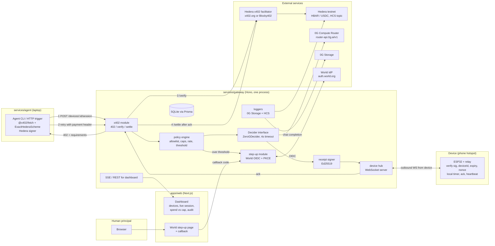
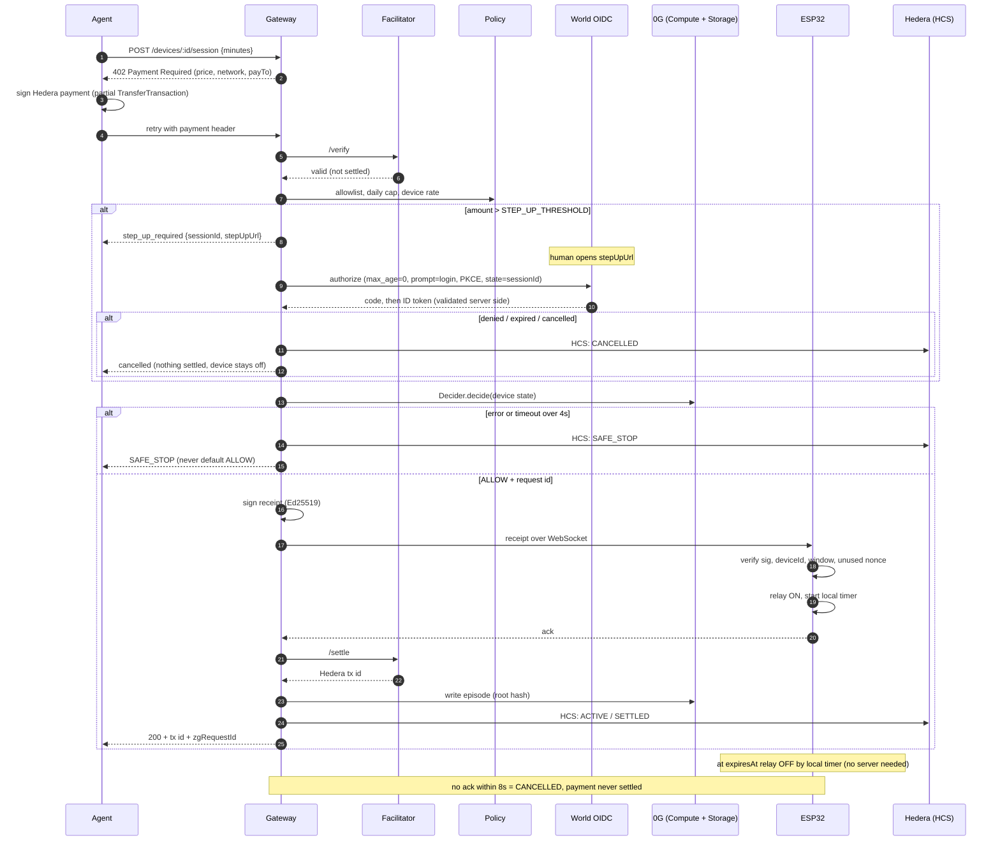
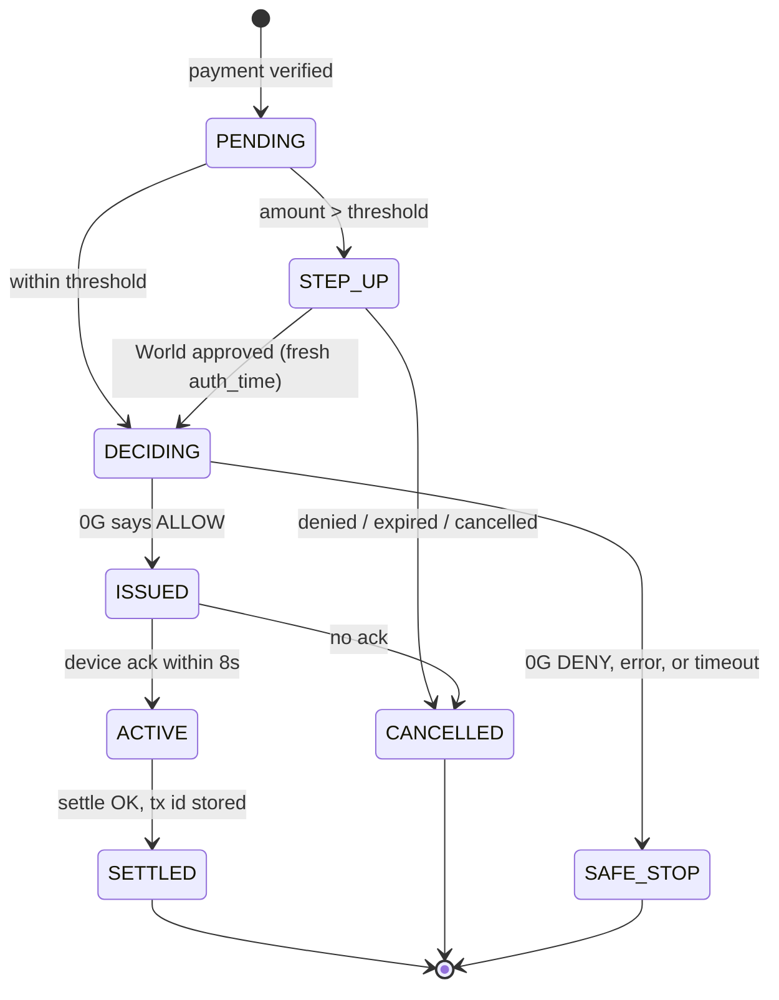
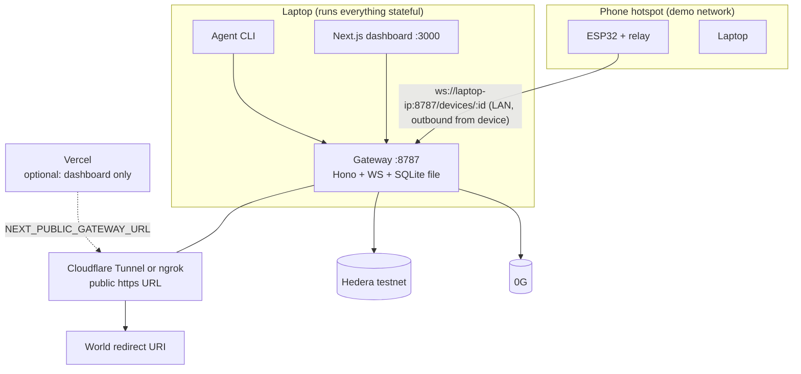

# AgentMeter

AI agents rent real machines (charger, locker, printer, rover) by paying **per minute over x402 on Hedera**. The device only switches on after it **verifies a signed, expiring receipt itself**. Above a spend limit a **human approves with fresh World ID**. Every decision runs through **0G**, and if 0G is unreachable the device **fails safe and stays off**.

Built at ETHGlobal Mumbai 2026 on top of [Paybot](https://github.com/superposition/paybot) (ETHGlobal Buenos Aires 2025). See [Credits](#credits).

> Status: setup done (docs, monorepo scaffold, shared contracts with receipt crypto merged). Lane work (gateway, web, web3 adapters, firmware) has not started. Items marked **(verify)** are unconfirmed facts to check before relying on them.

## Quick start

Prerequisites: Node 22+ (scripts run `.ts` directly on Node ≥22.18), pnpm 11, git. Hardware and API keys are not needed for the shared package or fakes.

```bash
pnpm install
cp .env.example .env                           # fill later; ADAPTERS=fake needs no keys
pnpm typecheck && pnpm test                    # 14 tests in packages/shared
node packages/shared/scripts/gen-keys.ts       # new receipt-signing seed + public key to pin in firmware
pnpm demo:scenarios                            # 8 demo cases against the real gateway + simulated ESP32 (no keys, no hardware)
```

Working on a lane in parallel: see [`docs/WORKFLOW.md`](docs/WORKFLOW.md) §2 (git worktrees) and your lane brief (`apps/web/CLAUDE.md`, `services/gateway/CLAUDE.md`, `packages/chain/CLAUDE.md`, `firmware/esp32/CLAUDE.md`).

### Submission sections still to add when results exist
Hedera tx ID(s) + HashScan links · HCS topic ID · 0G request IDs + Storage root hashes · "what breaks if 0G is removed" · safe-stop explanation · demo video links · link to `docs/WORLD_DEBRIEF.md`.
> Companion docs: [`PRD.md`](PRD.md) (requirements), [`CLAUDE.md`](CLAUDE.md) (working rules), [`docs/SCOPE.md`](docs/SCOPE.md) (source map, corrections).

---

## 1. Architecture

### 1.1 System diagram



### 1.2 Hero flow (sequence)



### 1.3 Session state machine



Rule: payment is settled **only** on the `ACTIVE → SETTLED` edge.

### 1.4 Deployment diagram



**Where things run**

| Component | Runs on | Why |
|---|---|---|
| Gateway | Laptop (demo). Backup: Render or Fly.io | Needs long-lived WebSockets and a writable SQLite file, so **not Vercel serverless** |
| Dashboard | Laptop `:3000`, or Vercel | Static/SSR is fine on Vercel; it must reach the gateway over a public URL |
| Agent | Laptop | Holds the Hedera payer key; never deployed |
| ESP32 | Phone hotspot | Venue Wi-Fi often isolates clients. Device connects **outbound** to the gateway; laptop must be on the same hotspot, or use the tunnel |
| World redirect URI | `http://localhost:3000/api/world/callback` for dev; tunnel URL if demoing remotely | Must match the portal registration exactly |

---

## 2. Integration guide, section by section

Each section: **source** (what we reuse), **how it plugs in**, **contract**, **keys**, **failure behavior**.

### 2.1 x402 on Hedera (gateway `x402` module)

- **Source:** `x402-foundation/x402` Hedera `exact` scheme (`@x402/hedera`, `@x402/core`, `@x402/fetch`); route shape from Paybot `example-resource-server.ts`.
- **How:** Protect `POST /devices/:id/session` with x402. Payment requirements: `network: "hedera:testnet"`, asset HBAR (`0.0.0`) first, USDC (HTS) later, `payTo` = device owner account. We use the `cryptoTransfer` method: client sends a base64 partially signed `TransferTransaction`; facilitator adds the fee-payer signature at settle.
- **Verify/settle split:** The spec defines separate `/verify` and `/settle`. Gateway calls `/verify` on request, `/settle` only after device ack. If the middleware package cannot split them, use the fallback: settle immediately, refund on no-ack (decide by Fri night, log in `docs/DECISIONS.md`).
- **Replay guard:** store `sha256(payment payload)` in `UsedNonce`/`Session.paymentPayloadHash`; reject reuse.
- **Keys:** none for `x402.org/facilitator` (testnet, no API key). Check `curl https://x402.org/facilitator/supported` lists `hedera:testnet`. Alternative: Blocky402 `https://api.testnet.blocky402.com`. Make it configurable via `X402_FACILITATOR_URL`.
- **Packaging risk:** `@x402/hedera` may not be on npm. If missing, add it as a workspace or git dependency from `typescript/packages/mechanisms/hedera` in the x402 monorepo. Budget 1 hour. **(verify)** hbar402 imports it, so a published or buildable version exists.
- **Failure:** facilitator timeout or error → typed error, session `CANCELLED`, nothing settled.

### 2.2 Agent payer (`services/agent`)

- **Source:** `OkeyAmy/hbar402` client pattern.
- **How:**
  ```ts
  const signer = createClientHederaSigner(AGENT_ID, PrivateKey.fromStringDer(AGENT_KEY), { network: "hedera:testnet" });
  const payingFetch = wrapFetchWithPaymentFromConfig(fetch, {
    schemes: [{ network: "hedera:testnet", client: new ExactHederaScheme(signer) }],
  });
  ```
  CLI: `agent rent --device d1 --minutes 10`. Handles `step_up_required` by printing the step-up URL and polling the session until `ACTIVE`/`CANCELLED`.
- **Keys:** `AGENT_HEDERA_ACCOUNT_ID`, `AGENT_HEDERA_PRIVATE_KEY` (DER). A **separate account** from the payTo/operator account.
- **Rule:** no human approves the payment itself. Humans only appear at step-up.

### 2.3 Policy engine (gateway `policy` module)

- **Source:** our own; no external reference.
- **Checks, in order:** device allowlist for this agent → per-agent daily cap (`Agent.spentToday` vs `dailyCap`) → per-device rate limit → threshold (`STEP_UP_THRESHOLD_HBAR`, default 2).
- **Output:** `ALLOW | STEP_UP | DENY(reason)`. Pure function over DB state, unit-tested.
- **Keys:** none.

### 2.4 World ID step-up (gateway `stepup` + `apps/web`)

- **Source:** `auth.world.org/docs/guides/step-up`; approval-binding idea from `Lyons800/remit`.
- **How:**
  1. Gateway creates a `StepUp` row bound to `sessionId`, with `state`, `nonce`, PKCE verifier, and the exact action (device, minutes, amount).
  2. Human opens `apps/web` step-up page showing that action; the page redirects to the World authorize endpoint (from OIDC discovery) with `scope=openid`, `max_age=0`, `prompt=login`, S256 PKCE, `state`, `nonce`.
  3. Callback `/api/world/callback` forwards the code to the gateway. **Gateway validates server-side:** `state`, single code redemption, ID token `iss`/`aud`/`exp`/`nonce`, `acr` against saved values, `auth_time` belongs to this attempt (not "age is zero"), then marks approval used atomically.
  4. Deny / cancel / expiry → `StepUp.status = DENIED|EXPIRED`, session `CANCELLED`, device never gets a receipt.
- **Pairwise `sub`:** store `worldSub` on `StepUp`; do not build an agent→human lookup table (remit rationale).
- **Keys:** `WORLD_OIDC_ISSUER` (from `https://auth.world.org/.well-known/openid-configuration`), `WORLD_CLIENT_ID`, `WORLD_CLIENT_SECRET`, `WORLD_REDIRECT_URI`. Register the app at `https://auth.world.org/portal`. Proofs are mocked for the hackathon; no sandbox app needed.
- **Deliverable:** `docs/WORLD_DEBRIEF.md` (time to first success, friction, missing docs, top improvement). Start the notes while building, not at the end.

### 2.5 0G decision (gateway `decider`)

- **Source:** 0G Compute Router (OpenAI-compatible); zerobot only as inspiration for a mock robot.
- **How:** `interface Decider { decide(input): Promise<{verdict:"ALLOW"|"DENY", reason, requestId}> }`. `ZeroGDecider` posts a chat completion to `ZG_COMPUTE_BASE_URL` (`https://router-api.0g.ai/v1`) with device state (online, last heartbeat, relay state, recent sessions). Force JSON output and validate with zod; anything unparseable is a failure.
- **Safe stop:** `AbortController` at 4s. **Any** error, timeout, non-JSON, or missing verdict → `SAFE_STOP`. There is no code path that returns ALLOW without a model response.
- **Request ID:** **(verify)** the compute overview page doesn't say where request IDs come from. Test a live call on day 1. If the Router doesn't return one, switch to the Direct path (`@0gfoundation/0g-compute-ts-sdk`, wallet-signed).
- **Keys:** `ZG_COMPUTE_API_KEY` from `https://pc.0g.ai`, `ZG_MODEL` (pick from `https://pc.0g.ai/models`; the PRD's `0gm-1.0` is **(verify)**). Credits: 0G booth on day 1.
- **"What breaks without 0G":** the device cannot be switched on. That is the one-sentence answer the prize asks for.

### 2.6 0G Storage episode log (gateway `loggers`)

- **Source:** 0G Storage SDK docs (`docs.0g.ai/developer-hub/building-on-0g/storage/sdk`). Package name and API **(verify)** against the docs before coding.
- **How:** after every decision (including DENY and SAFE_STOP) upload one JSON episode: `{sessionId, deviceId, agentId, input, verdict, reason, zgRequestId, receiptHash, timestamps}`. Store the returned root hash in `Session.zgRootHash`. Upload failure is logged and retried; it must not flip a decision.
- **Keys:** `ZG_STORAGE_RPC`, `ZG_STORAGE_INDEXER`, `ZG_PRIVATE_KEY` (funded from `https://faucet.0g.ai`). Server only.

### 2.7 Hedera HCS audit log (gateway `loggers`)

- **Source:** `@hashgraph/sdk` (`TopicCreateTransaction`, `TopicMessageSubmitTransaction`) **(verify exact package: hbar402 uses `@hiero-ledger/sdk`)**.
- **How:** one topic created once (`HEDERA_HCS_TOPIC_ID`); one message per session state change: `{sessionId, state, ts, txId?, zgRequestId?}`. Store `hcsSeq`. Dashboard links to HashScan.
- **Keys:** `HEDERA_OPERATOR_ID`, `HEDERA_OPERATOR_KEY` (pays HCS fees), `HEDERA_HCS_TOPIC_ID`.

### 2.8 Receipt signing (`packages/shared` + gateway `receipts`)

- **Source:** our design; Node `crypto` Ed25519 (no dependency).
- **Canonical encoding (proposed, log in DECISIONS.md):** UTF-8 string, fixed field order, `|` separated, no JSON ambiguity:
  `AMv1|deviceId|sessionId|nonceHex(32)|notBefore|expiresAt|amountTinybar|payer`
  Signature = Ed25519 over those bytes, base64. Timestamps are unix seconds.
- **Test vector:** `packages/shared/test-vectors/receipt.json` with private seed, public key, message, signature. Node tests and firmware both verify it.
- **Keys:** `RECEIPT_SIGNING_KEY_ED25519` (base64 seed, server only). Public key is compiled into firmware or flashed once over serial.

### 2.9 Device hub and WebSocket protocol (gateway `devices`)

- **Source:** `links2004/arduinoWebSockets` on the device; `ws` or Hono's WS helper on the server.
- **Messages (JSON):**
  - device → server: `{type:"hello", deviceId, fw, ts}` · `{type:"heartbeat", deviceId, relay, ts}` every 5s · `{type:"ack", sessionId, nonce, relay:true, ts, mac}` · `{type:"nack", sessionId, reason}`
  - server → device: `{type:"receipt", receipt:{...}, sig}` · `{type:"cancel", sessionId}`
- **Ack authenticity (proposed):** HMAC-SHA256 with a per-device secret provisioned at flash time; keeps firmware small (verify-only Ed25519 plus HMAC). Log in DECISIONS.md.
- **Auth for the socket:** device token in the connect URL query, checked against `Device`. Mark `status=OFFLINE` after 15s without heartbeat.
- **Timeout:** no ack in **8s** → session `CANCELLED`, no settle.

### 2.10 ESP32 firmware (`firmware/esp32`)

- **Source:** PlatformIO; `rweather/arduinolibs` Ed25519 **(verify class and header; last noted repo change 2023)**; `links2004/arduinoWebSockets`; ArduinoJson. Fallback if Ed25519 fights you: HMAC-SHA256 per-device secret, trade-off noted in DECISIONS.md.
- **Device checks, all required:** signature valid against pinned key; `deviceId` equals own; `notBefore - 30s ≤ now ≤ expiresAt + 30s`; nonce not in ring buffer (store last N=32). Then relay ON, start timer for `expiresAt - now`, send ack.
- **Local timer:** relay turns OFF at expiry even with no network.
- **Clock:** NTP sync on boot; refuse receipts until synced.
- **Hardware safety:** use a low-voltage load (LED strip, fan, small charger) through the relay for the demo, not mains.
- **Config:** Wi-Fi SSID/password, gateway host, device id, device token, pinned public key, HMAC secret, relay GPIO, in a git-ignored `secrets.h`.
- **Demo failure modes:** replay → `nack(replay)`; unplug → no ack; wrong device → `nack(device)`.

### 2.11 Dashboard (`apps/web`)

- **Source:** Paybot `BotAccessGate`, `CountdownTimer`, `usePayment` as UX references only. Next.js App Router + Tailwind + shadcn/ui (not Vite, not wagmi).
- **Pages:** `/` devices (status, heartbeat, price) · `/sessions/[id]` live session with countdown and state timeline · `/agents` spend vs cap · `/audit` list with HashScan tx link, HCS seq, 0G request ID and root hash · `/step-up/[id]` World approval page · `/api/world/callback`.
- **Live data:** SSE from the gateway (`GET /events`) with REST fallback.
- **Rule:** no private keys in the browser. The browser only talks to the gateway.

### 2.12 Persistence (`packages/db`)

Prisma + SQLite (`DATABASE_URL=file:./dev.db`). Models per PRD §7: `Device`, `Agent`, `Session`, `StepUp`, `UsedNonce`. Single-writer; fine for one gateway process.

---

## 3. Gateway API contract (proposed)

| Method | Path | Purpose |
|---|---|---|
| POST | `/devices/:id/session` | x402-protected. 402 → pay → returns `{sessionId, state}` or `step_up_required` |
| GET | `/sessions/:id` | Session state, tx id, 0G ids, HCS seq |
| POST | `/stepup/:sessionId/start` | Returns authorize URL (PKCE, state) |
| GET | `/stepup/callback` | Receives code from web, validates, resumes or cancels |
| GET | `/devices` | Device list + status |
| GET | `/agents` | Agents + spend vs cap |
| GET | `/audit` | Sessions with links |
| GET | `/events` | SSE stream of state changes |
| WS | `/devices/:id` | Device channel (section 2.9) |
| GET | `/health` | Liveness |

Every external call has a timeout and a typed error: facilitator, 0G Compute, 0G Storage, Hedera, World.

---

## 4. Accounts, keys, and where to get them

| # | What | Where | Used by | Env var(s) | Cost / note |
|---|---|---|---|---|---|
| 1 | Hedera testnet **operator** account | https://portal.hedera.com | HCS topic, fees | `HEDERA_OPERATOR_ID`, `HEDERA_OPERATOR_KEY` | Free testnet HBAR |
| 2 | Hedera **payTo** account (device owner revenue) | portal.hedera.com | x402 payee | `HEDERA_PAYTO_ACCOUNT_ID` | Free |
| 3 | Hedera **agent** account (payer) | portal.hedera.com | `services/agent` | `AGENT_HEDERA_ACCOUNT_ID`, `AGENT_HEDERA_PRIVATE_KEY` | Fund with HBAR |
| 4 | Testnet USDC (P1) | Circle faucet, choose Hedera Testnet, use `0.0.x` ID | Agent payer | `HEDERA_USDC_TOKEN_ID` (default `0.0.429274` **(verify)**) | Token association needed |
| 5 | HCS topic | Created by script in step 8 | Audit log | `HEDERA_HCS_TOPIC_ID` | Operator pays |
| 6 | x402 facilitator | `https://x402.org/facilitator` or Blocky402 | Gateway | `X402_FACILITATOR_URL` | No API key (testnet) |
| 7 | 0G Compute API key + credits | https://pc.0g.ai, booth on day 1 | Decider | `ZG_COMPUTE_BASE_URL`, `ZG_COMPUTE_API_KEY`, `ZG_MODEL` | Credits limited |
| 8 | 0G Storage wallet | https://faucet.0g.ai, https://build.0g.ai | Episode log | `ZG_STORAGE_RPC`, `ZG_STORAGE_INDEXER`, `ZG_PRIVATE_KEY` | Testnet funds |
| 9 | World OIDC client | https://auth.world.org/portal | Step-up | `WORLD_OIDC_ISSUER`, `WORLD_CLIENT_ID`, `WORLD_CLIENT_SECRET`, `WORLD_REDIRECT_URI` | Redirect URI must match exactly |
| 10 | Receipt signing key | Generated locally by script | Gateway | `RECEIPT_SIGNING_KEY_ED25519` | Never commit |
| 11 | Tunnel (optional) | `cloudflared` or `ngrok` | Public URL for World callback / remote device | none | Free tier |
| 12 | Hosting (optional) | Vercel (dashboard), Render or Fly.io (gateway backup) | Deploy | platform env | Free tiers |
| 13 | Hardware | ESP32 dev board, 1-channel relay, low-voltage load, USB cable | Device | — | — |

### `.env.example` (to be created in Step 1)

```
# Hedera
HEDERA_NETWORK=testnet
HEDERA_OPERATOR_ID=0.0.x
HEDERA_OPERATOR_KEY=302e...
HEDERA_PAYTO_ACCOUNT_ID=0.0.x
HEDERA_HCS_TOPIC_ID=0.0.x
HEDERA_USDC_TOKEN_ID=0.0.429274
X402_FACILITATOR_URL=https://x402.org/facilitator

# Agent (separate payer account)
AGENT_HEDERA_ACCOUNT_ID=0.0.x
AGENT_HEDERA_PRIVATE_KEY=302e...

# 0G
ZG_COMPUTE_BASE_URL=https://router-api.0g.ai/v1
ZG_COMPUTE_API_KEY=
ZG_MODEL=
ZG_STORAGE_RPC=
ZG_STORAGE_INDEXER=
ZG_PRIVATE_KEY=

# World ID
WORLD_OIDC_ISSUER=
WORLD_CLIENT_ID=
WORLD_CLIENT_SECRET=
WORLD_REDIRECT_URI=http://localhost:3000/api/world/callback

# Gateway
RECEIPT_SIGNING_KEY_ED25519=
STEP_UP_THRESHOLD_HBAR=2
ACK_TIMEOUT_MS=8000
ZG_TIMEOUT_MS=4000
DATABASE_URL=file:./dev.db
PORT=8787
```

Secrets rule: private keys live only in `.env` (git-ignored) and the firmware `secrets.h` (git-ignored). Never in `apps/web` client code.

---

## 5. Repository layout

```
agentmeter/
├─ apps/web/                 Lane A web: Next.js dashboard + World step-up pages
├─ services/
│  ├─ gateway/               Lane B backend: Hono, policy, state machine, orchestrator, WS hub, SSE
│  └─ agent/                 Lane B backend: autonomous payer CLI + HTTP trigger
├─ packages/
│  ├─ shared/                Core: zod schemas, ports, fakes, errors, receipt crypto, test vectors
│  ├─ chain/                 Lane C web3: x402/Hedera, HCS, 0G Compute + Storage, World OIDC adapters
│  └─ db/                    Lane B backend: Prisma schema + repositories
├─ firmware/esp32/           Lane D firmware: PlatformIO project
├─ docs/                     ARCHITECTURE, API, WORKFLOW, DECISIONS, RESOURCES, SCOPE, STATE, lanes/
├─ reference/paybot/         cloned, git-ignored
├─ PRD.md  TRD.md  CLAUDE.md  README.md
```

Docs map: [`PRD.md`](PRD.md) what/why · [`TRD.md`](TRD.md) technical requirements · [`docs/ARCHITECTURE.md`](docs/ARCHITECTURE.md) layers and ports · [`docs/API.md`](docs/API.md) wire contracts · [`docs/WORKFLOW.md`](docs/WORKFLOW.md) parallel lanes and stacked PRs · [`docs/DECISIONS.md`](docs/DECISIONS.md) ADR log · [`docs/STATE.md`](docs/STATE.md) live project state.

---

## 6. Build order and "done" checks

| # | Step | Done when |
|---|---|---|
| 1 | Scaffold, Prisma, `.env.example`, DECISIONS.md | `pnpm install` + typecheck pass |
| 2 | Agent pays dummy x402 endpoint on Hedera testnet | Tx ID on HashScan. **Stop and confirm** |
| 3 | Receipts + test vector | Node round-trip test passes |
| 4 | Firmware | Script-signed receipt flips relay; replay rejected; timer off; ack sent |
| 5 | Gateway E2E | Paid unlock, no UI; no ack = no settle |
| 6 | Policy + World step-up | Over-cap blocked until World ID; cancel leaves device off |
| 7 | 0G decider + Storage + SAFE_STOP | Request ID + root hash stored; blocked 0G = SAFE_STOP |
| 8 | HCS logger | One message per state change |
| 9 | Dashboard | Live session with countdown |
| 10 | Docs, video, submit | PRD §12 checklist |

**Rule:** no P1 (USDC, camera, Agent Kit) before step 5 works end to end.

---

## 7. Demo and test checklist

- Happy path: agent pays, relay clicks, HashScan tx + 0G request ID shown.
- Replay same receipt → device rejects.
- Over cap → World prompt → human cancels → nothing happens; then approve → works.
- Block 0G → `SAFE_STOP`, device stays off.
- Unplug device → no ack → no settlement.
- Before recording: fresh testnet balances, phone hotspot, NTP synced, redirect URIs match, HashScan links open.
- Video rules: ≤3 min (finalist/0G), ≤5 min (Hedera), no sped-up footage, no phone recording, no AI voiceover.

---

## 8. Open items (check before building)

- Submission deadline: reported Sun 8 Nov 09:00 IST. Not on the prizes page; confirm on Discord.
- Does the x402 Hedera middleware allow verify without settle? (Spec says yes; confirm in code.)
- Where does a 0G request ID come from on the Router path?
- Does rweather's library expose Ed25519 sign/verify on ESP32?
- Exact 0G Storage SDK package and call shape.
- Exact Hedera SDK package: `@hashgraph/sdk` vs `@hiero-ledger/sdk`.

---

## Credits

Built on top of **Paybot** by the superposition team (ETHGlobal Buenos Aires 2025). Uses **x402** (x402 Foundation), the **Hedera** SDK, **0G** Compute and Storage (zerobot as reference), **World ID**, `rweather/arduinolibs`, `links2004/arduinoWebSockets`, and ArduinoJson. Approval-binding pattern informed by `Lyons800/remit`; client pattern by `OkeyAmy/hbar402`.

AI use: Claude Code assisted with planning and implementation; all keys, hardware, and demo decisions are the team's.

## License

MIT (add `LICENSE` in step 1).
