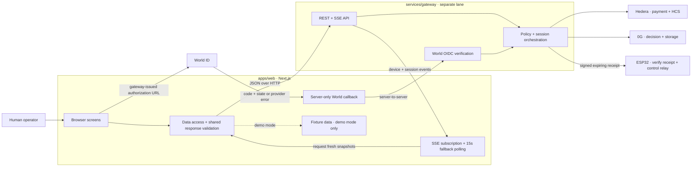
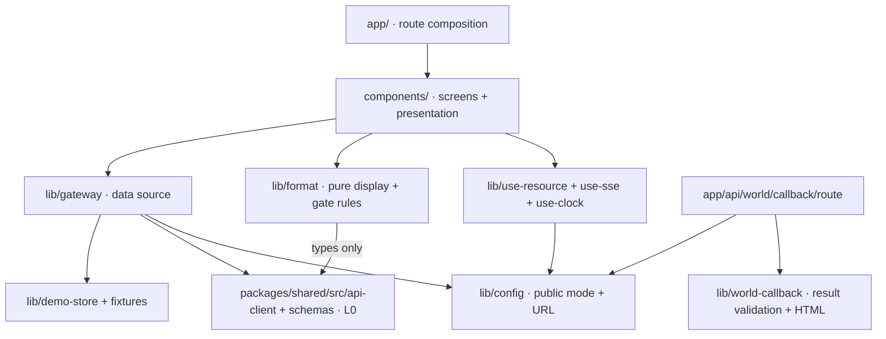

# Frontend architecture

AgentMeter observes device access and lets a human review an agent's requested action. **The gateway and device enforce access. The frontend displays their state.** A countdown or an approval result never independently turns on a relay.

## Public website and documentation

The public homepage is `/`; the fleet dashboard is `/devices`. `/docs` is a browsable guide index with search, and `/docs/[slug]` renders a guide without login. The documentation is sourced from an explicit server-side allowlist in `src/lib/docs.ts`, including frontend guides and published project/API specifications. Arbitrary paths cannot be read through a documentation URL. The `/docs/[slug]/raw` route downloads the same source as Markdown.

Public components live in `components/landing/`, `components/docs/`, `public-header.tsx` and `public-footer.tsx`. Their styles are scoped in `app/public.css` and `app/docs/docs.css`. A small server-rendered Markdown renderer escapes text, resolves known source-relative links into public URLs, renders code/tables and exposes accessible diagram relationships. Code-copy buttons and guide search are client components; filesystem reads stay on the server.

The landing page's receipt calculator and stage selector are explanatory only. Product preview images under `public/media/` are screenshots of the fixture dashboard, captured with `scripts/capture-product.mjs`. Landing, docs, dashboard and approval preview routes have no login gate. World ID is still required only for a real session's configured step-up checkpoint.

## 1. System map



Solid external connections describe the intended integration boundary. In the current checkout, the production gateway's dashboard routes are still being built in another lane. The local contract harness exercises the frontend side of these connections without contacting Hedera, 0G, World, or hardware.

## 2. Dependency direction



The shared package's root barrel also exports Node crypto and receipt signing. Browser code deliberately imports its **`src/api-client` and `src/schemas` subpaths**, not the barrel. Shared port fakes use Node crypto and contain no dashboard dataset, so `fixtures.ts` supplies browser-safe data checked against the exact shared runtime schemas. No shared package changes are required.

## 3. Folder responsibilities

```text
apps/web/
├── src/app/                    Route composition, global style, error/not-found boundaries
│   ├── page.tsx                Public landing page
│   ├── devices/                Fleet
│   ├── docs/                   Public guide index, guide pages and Markdown downloads
│   ├── agents/                 Agent budgets
│   ├── audit/                  Session evidence table
│   ├── sessions/[id]/          Session receipt
│   ├── step-up/[sessionId]/    Exact-action review
│   ├── api/world/callback/     Server-only callback forwarding
│   └── demo/approval/[result]/ Fixture-only result previews
├── src/components/
│   ├── app-shell.tsx           Brand, navigation, workspace, skip link
│   ├── dashboard/             Control room, fleet, budgets, audit, live-session panel
│   ├── session-detail.tsx     Receipt state, countdown, evidence and timeline
│   ├── step-up.tsx            Action review and authorization handoff
│   ├── demo-scenarios.tsx     Labeled fixture navigation
│   ├── ui/                    Small reusable controls
│   └── react-bits/            Upstream animation source
├── src/lib/
│   ├── config.ts              Explicit fixture/live selection
│   ├── gateway.ts             Typed HTTP reads, partial-failure handling, approval start
│   ├── use-resource.ts        Fetch lifecycle, queued updates, polling, route cleanup
│   ├── use-sse.ts             Validated device/session events, reconnect and cleanup
│   ├── use-clock.ts           Display clock, one-second updates
│   ├── format.ts              BigInt money, ratios, heartbeat age, access-gate display
│   ├── fixtures.ts            Deterministic sample data, optional fixed epoch
│   ├── demo-store.ts          Consistent per-tab fixture epoch and session lookup
│   └── world-callback.ts      Callback contract validation and safe result response
├── scripts/                   Local contract gateway and browser verification
├── test/                      Financial, safety, data-boundary and callback tests
└── docs/                      Architecture, development, testing and handoff
```

## 4. Read and refresh lifecycle

```mermaid
sequenceDiagram
  participant Screen
  participant Resource as useResource
  participant Source as gateway.ts
  participant API as Gateway REST/SSE
  Screen->>Resource: mount or route ID changes
  Resource->>Source: load(previous snapshot)
  par Independent reads
    Source->>API: GET /devices
    Source->>API: GET /agents
    Source->>API: GET /audit?limit=50
  end
  API-->>Source: JSON validated by shared schemas
  Source->>API: GET /sessions/:id for latest in-progress audit row
  API-->>Source: SessionView
  Source-->>Screen: snapshot + per-endpoint issues
  API-->>Resource: validated device/session event
  Resource->>Source: queue fresh snapshot
  Note over Resource: Also poll every 15s while visible; refresh on tab return
```

There is no `/sessions` list endpoint in the shared API. The fleet panel finds the newest in-progress row in the loaded audit window and fetches that session. It is a **latest live session preview**, not a claim that all active sessions have been enumerated. Direct session routes work independently of that window.

`Promise.allSettled` keeps a failed agents request from erasing the device fleet. Last-good failed blocks remain visible behind an explicit stale warning. A failed session read yields no unlocked panel. Failed audit reads mark the panel unverified. Session detail retains prior context but locks its displayed gate after a failed refresh. Successful recovery clears the warning.

EventSource reconnects natively. `onopen` forces a read after reconnect; payloads must pass shared Zod schemas. A burst queues one additional fetch after an in-flight fetch, so an update is not lost. Polling is a fallback for dropped events or a gateway without SSE. Generation checks discard results from a route that has been left; timers and streams close on unmount.

## 5. Access and money invariants

| Concern | Frontend rule | Enforcement owner |
| --- | --- | --- |
| Access shown unlocked | Fresh `ACTIVE` session **and** non-null future `expiresAt` | Gateway/device enforce; browser only displays |
| Receipt expiry | Clamp countdown to zero at the exact expiry; gate locks | Device's independent receipt timer |
| SAFE_STOP / CANCELLED | Visible banner, locked gate even with future expiry | Gateway orchestrator and device |
| Approval | Exact device, duration, amount, asset and state re-read before redirect | Gateway binds OIDC action and state |
| Money | Base-unit decimal strings stay BigInt; no float conversion of balances | Shared money schema and gateway ledger |
| Budget | Ratio supports hundredths of a percent; bar capped at 100; excess and zero cap explicit | Gateway policy, not the progress bar |
| Missing evidence | Print “Not recorded” or a dash; never manufacture proof | Gateway persistence and audit adapters |
| 0G evidence | Show complete request ID/root; no invented explorer route | Contract currently exposes opaque identifiers |

## 6. World approval boundary

```mermaid
sequenceDiagram
  participant Human
  participant Review as Browser action review
  participant Gateway
  participant World as World ID
  participant Callback as Next.js callback server
  Human->>Review: open /step-up/:sessionId
  Review->>Gateway: GET /sessions/:id
  Gateway-->>Review: exact device + minutes + amount + asset + state
  Human->>Review: Continue to World ID
  Review->>Gateway: re-read session; POST /stepup/:id/start
  Gateway-->>Review: HTTPS authorizeUrl
  Review->>World: navigate to gateway-issued URL
  World->>Callback: code,state OR error,state
  Callback->>Gateway: GET /stepup/callback with original parameters
  Note over Gateway: Validate state, nonce, PKCE, token, freshness and action binding
  Gateway-->>Callback: sessionId + APPROVED / DENIED / EXPIRED
  Callback-->>Human: non-cacheable result with bound session link
  Human->>Review: inspect fresh session state
```

The callback accepts only the three exact string results and a nonempty session ID. Unknown results, missing state, upstream failures, timeouts, and malformed responses never render a successful approval. Content is escaped and result pages are non-cacheable with no-referrer headers. A provider denial is forwarded with `error,state`; the backend must support that branch to close the pending request. The local harness and callback tests cover it; production OIDC verification is owned by the backend lane.

No client secret, signing seed, payer key, OIDC verifier or identity proof is stored by this frontend. `GATEWAY_SERVER_URL` may override callback forwarding on the server; browser traffic always uses `NEXT_PUBLIC_GATEWAY_URL`.

## 7. Deliberate scope

The browser does not initiate x402 payments, sign receipts, override gateway state, cancel hardware sessions through an undocumented endpoint, or locally approve a live request. The fixture outcome previews are isolated demo routes and unavailable in live mode. The development gateway is a loopback-only contract harness under `scripts/`, outside the deployed Next.js routes.

To add a screen, create a route, keep rendering in `components/`, put HTTP or fixture selection in `lib/gateway.ts`, validate new contracts through L0, and add boundary/safety tests. Changes to shared schemas or production gateway endpoints follow the repository's separate lane protocol.
